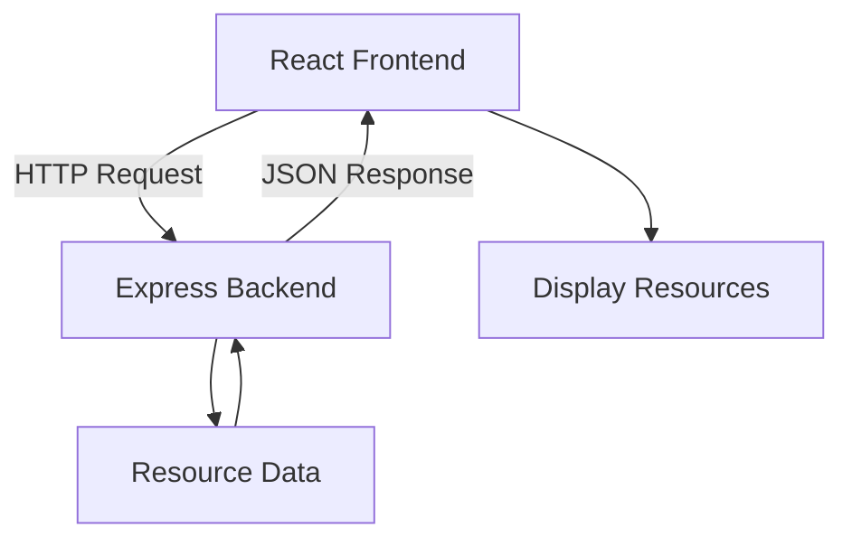
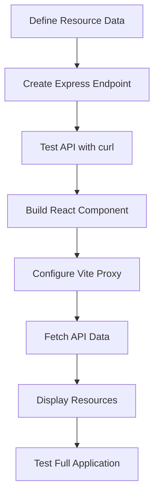

# React + Express Starter Template

A simple full-stack starter template using React, Vite, Node.js, Express. This project demonstrates how to create a REST API, fetch data from React, and display the results in the browser.

## Project Structure

```text
app/
├── server/
│   ├── index.js
│   ├── package.json
│   └── pnpm-lock.yaml
│
└── client/
    ├── src/
    │   ├── App.jsx
    │   ├── resList.jsx
    │   ├── main.jsx
    │   └── index.css
    ├── vite.config.js
    ├── package.json
    └── pnpm-lock.yaml
```

## 1. Foundation

### Technologies

| Technology | Purpose |
|---|---|
| Node.js | Runs JavaScript on the backend |
| pnpm | Manages dependencies and project scripts |
| Express | Creates the backend server and REST API |
| React | Builds the user interface |
| Vite | Runs the frontend development server |
| Fetch API | Sends HTTP requests from React to Express |

### Architecture Overview

The application has two independent parts:

- **Backend:** Handles HTTP requests and returns resource data.
- **Frontend:** Fetches data from the API and displays it to users.



For this template, resources are stored in a JavaScript array. A database can be added later without changing the API contract.

## 2. Backend 

### Setup

Open a terminal in the project directory:

```bash
cd server
pnpm install
```

### API Endpoint

**Endpoint:** `GET /api/resources`

**Local URL:** `http://localhost:3000/api/resources`

The endpoint returns a JSON response:

```json
{
  "data": [
    {
      "id": "1",
      "title": "Introduction to Algorithms",
      "type": "RECORDING"
    }
  ]
}
```

### Understand the backend request flow


Express matches the incoming request to the route, reads the resource array, and sends the data as JSON.

### Run the Backend

```bash
pnpm dev
```

The backend runs at:

`http://localhost:3000`

### Test the API

```bash
curl http://localhost:3000/api/resources
```

## 3. Frontend 

### Setup

Open a second terminal from the project directory:

```bash
cd client
pnpm install
```

### Frontend Responsibilities

1. Fetches resources from the API.
2. Displays a loading message while waiting.
3. Handles request errors.
4. Stores the response in React state.
5. Renders each resource.

### Request flow


### Run the Frontend

```bash
pnpm dev
```

Open the local URL displayed by Vite, usually:

`http://localhost:5173`

## 4. Frontend Communicating with Express

The frontend and backend run on separate development servers.

| Application | Local URL |
|---|---|
| React + Vite | `http://localhost:5173` |
| Express API | `http://localhost:3000` |

### Vite Proxy Configuration

The frontend uses a development proxy to forward `/api` requests to Express.

```javascript
server: {
  proxy: {
    "/api": {
      target: "http://localhost:3000",
      changeOrigin: true,
    },
  },
}
```

React can then request the API using:

```javascript
const response = await fetch("/api/resources");
const result = await response.json();
```

The API response contains the `data` array, which React stores in state and renders.

### Complete Communication Flow


**Note:** The Vite proxy is for local development. Production deployment requires an appropriate frontend and backend API configuration.

## 5. Development Workflow

### Start the Applications

Run the backend and frontend in separate terminals.

**Terminal 1 — Backend**

```bash
cd server
pnpm install
pnpm dev
```

**Terminal 2 — Frontend**

```bash
cd client
pnpm install
pnpm dev
```

### Verify the Application

- [ ] Express starts successfully.
- [ ] `GET /api/resources` returns JSON.
- [ ] React opens in the browser.
- [ ] The frontend fetches resources successfully.
- [ ] Resource titles, types, and IDs appear on the page.
- [ ] Multiple resources can be displayed.

### Overall Development Workflow



## 6. Future Improvements

This template can be extended with:

- TypeScript and Zod validation
- PostgreSQL and Prisma
- Search, filtering, and pagination
- Automated API and integration tests
- Authentication and authorization
- Production deployment

## Resources

- [Node.js Documentation](https://nodejs.org/en/learn)
- [Express Documentation](https://expressjs.com/)
- [React Documentation](https://react.dev/learn)
- [Vite Documentation](https://vite.dev/guide/)
- [pnpm Documentation](https://pnpm.io/)
- [MDN Fetch API](https://developer.mozilla.org/en-US/docs/Web/API/Fetch_API)

---
